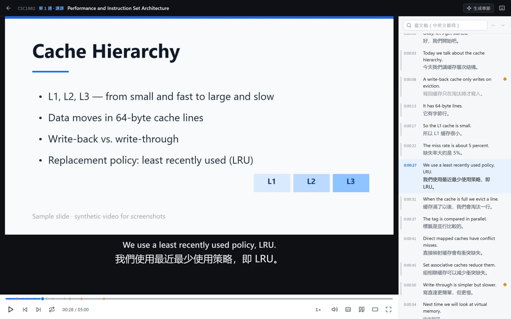
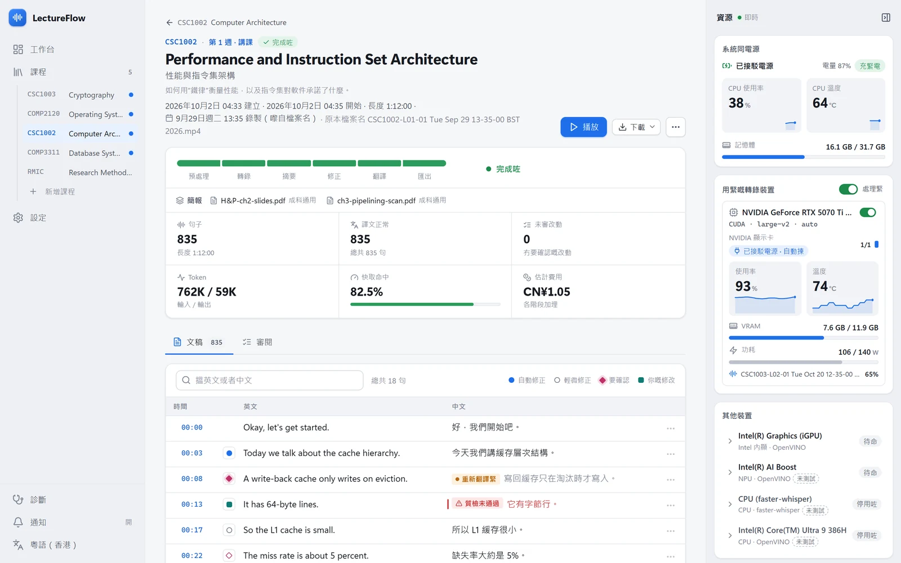
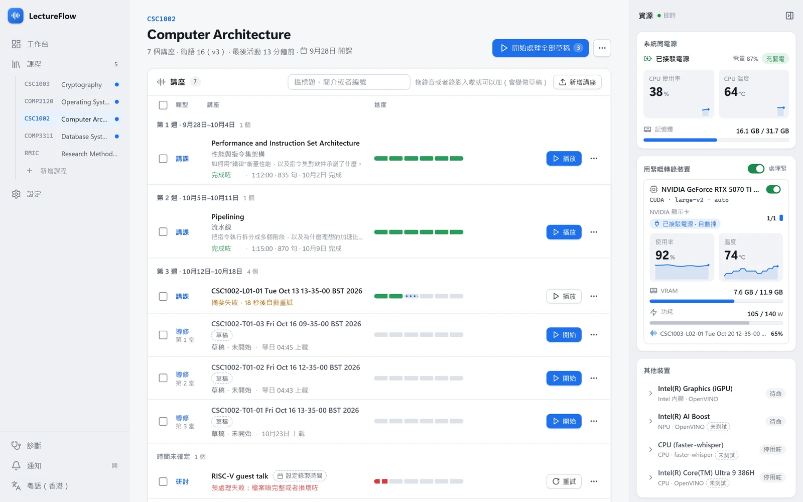

<h1 align="center">LectureFlow</h1>

<a href="README.md">English</a> · <a href="README.zh-CN.md">简体中文</a> · <a href="README.yue-HK.md">粵語</a>

  
  
  

**畀每一個第一次聽唔晒嘅人，一個唔使慌嘅第二次機會。**

一個睇落簡單、但其實唔簡單嘅講課聽寫同翻譯工具，或者仲有更多。

LectureFlow 係一個喺你自己部電腦度行嘅講課工具。將堂課嘅錄影拉入去，佢會喺本機將把聲轉做文字，參考你嘅課程大綱同簡報執返啲聽錯嘅地方，翻譯做你嘅母語，然後喺一個唔會遮住簡報嘅播放器度，陪你將堂課再睇多一次。

<picture>
  <source media="(prefers-color-scheme: dark)" srcset="docs/images/readme/player-yue-HK-dark.webp">
  
</picture>

截圖用嘅係虛構嘅示範資料同合成簡報。

## 點解會有 LectureFlow

**1. 用學費買返嚟嘅「智能字幕」**
大學每年畀咗唔少錢買商業錄影平台，換返嚟嘅係：字幕將 “cache” 寫成 “cash”，好似老師轉咗講理財咁；成五行字壓喺簡報正中間，公式同字幕只可以二揀一；播放器到而家都未學識「返去上一句」。錢係學校畀，苦係學生捱。LectureFlow 想證明：呢啲問題，一部普通手提電腦就解決到。

**2. AI 乜都識，就係唔記得老師喺邊度講**
將成堂課嘅抄本掟畀 AI，佢會好有自信咁講解一輪；至於呢句說話係老師第幾分鐘講，佢一概唔知，你都冇辦法查證。LectureFlow 匯出嘅每一句都帶住準確到秒嘅引用，交畀任何 AI 整理筆記，佢寫低嘅每個結論都可以一撳就跳返去堂上原聲。

**3. 預設你係講英文大嘅**
錄影平台嘅字幕得一種語言。但係當你用第二語言上堂，擋住你嘅往往唔係知識，而係嗰個聽唔清嘅字、嗰句講得太快嘅長句。LectureFlow 將成堂課翻譯做你嘅母語，逐句對照。

**4. 譯得越順，錯得越自然**
冇術語表嘅機器翻譯淨係可以靠估：“block” 係「塊」定「分組」，全靠彩數；老師嘅口誤同識別錯誤，佢會照單全收，再譯成一句文法完美嘅廢話。LectureFlow 會先由你嘅大綱同簡報整理出呢科嘅術語表，再根據成堂課嘅上下文執返識別錯誤，最後先開始翻譯。

**5. 按月畀錢，買一份冇得核對嘅摘要**
唔少「一撳就將講課變筆記」嘅產品按月收費：將你啲錄影傳上佢哋嘅伺服器，用一個唔識你呢科嘅語音識別轉做文字，再寫一份好靚但冇得查證嘅摘要；你啲錄影離開咗你部電腦，筆記就鎖死喺佢哋個 app 度。LectureFlow 唔幫你寫筆記，而係令任何筆記都可以被核對：錄影留喺本機，地基先執好，引用準確到秒，匯出嘅檔案永遠屬於你。

## 佢係做畀邊個用

上堂嘅時候，大家好似默認咗每個人都可以專心坐足一個鐘、一次聽明、即場抄好筆記。現實係好多人做唔到——同叻唔叻冇關係：

- **用第二語言上堂嘅留學生**：唔使喺「聽明英文」同「明白內容」之間二揀一。
- **精神同時間都有限嘅學生**：要返工嘅、要照顧屋企人嘅、隔咗幾年先返嚟讀書嘅。堂課可以遲啲先睇、分幾次睇。
- **要照顧專注力同精神健康嘅學生**：走咗神？一撳就返去啱啱嗰句。聽唔明？嗰句重播幾多次都得。
- **聽力唔方便、閱讀比較慢嘅學生**：專業術語準確嘅字幕，字體大細同播放速度都可以調。
- **得一部普通手提電腦嘅學生**：唔使貴價獨立顯示卡，甚至可以一蚊都唔使使。

如果你試過因為走漏咗一堂而好擔心，或者對住一段聽唔清楚嘅錄影不停拉返轉頭，呢個工具就係為你做嘅。

## 佢可以做啲咩

**將錄影變成可以溫書嘅講稿**

- 喺本機將講課轉成逐句、有時間戳嘅文稿。
- 根據課程大綱同簡報整理術語表，再由另一個模型「清道夫」執好，專業術語由第一句開始就啱。
- 參考成堂課嘅摘要同前後文執返聽錯嘅地方、逐句翻譯；冇把握嘅修改會標記出嚟，可以撳入去聽返原聲確認。
- 自動幫每堂課整中英文標題、一句簡介同章節。

<picture>
  <source media="(prefers-color-scheme: dark)" srcset="docs/images/readme/lecture-yue-HK-dark.webp">
  
</picture>

**為溫書而設計嘅播放器**

- 字幕放喺影片下面嘅獨立位置，**唔會遮住簡報同黑板**。
- 逐句文稿跟住播放捲動，撳邊句就跳去邊句。
- 上一句、下一句、單句重播、慢速播放，全部都有快捷鍵。
- 閂咗再開，會由上次嘅位置繼續；一撳就複製準確到秒嘅引用。

**自動執好你啲科**

- 由 AI 根據你嘅檔案名寫出解析規則，按錄影日期自動編號（例如 `W02L1`：第 2 週第 1 節），按教學週分組。
- 分得出講課、導修、研討等唔同類型。

<picture>
  <source media="(prefers-color-scheme: dark)" srcset="docs/images/readme/course-yue-HK-dark.webp">
  
</picture>

**識睇電源面色嘅轉寫**

- 自動揀 NVIDIA 顯示卡、Intel 內置顯示卡或者 NPU、Apple Silicon 嚟轉寫。
- 手提電腦一次淨係用一部轉寫裝置：駁電用獨顯，唔駁電就轉去慳電啲嘅 NPU；搬唔到嘅工作會暫停，駁返電再繼續。
- 可以揀借用 Google Colab 嘅 GPU：自動開機、轉寫、攞返結果、熄機，一蚊都唔會畀佢燒多咗。

**慢慢嚟，唔催你**

- 加咗堂課、撳一次「開始」，之後全部自動搞掂，唔使你喺度睇住。
- 檢查修改係自選嘅：有精神就睇吓，冇精神就直接用整好嘅講稿溫書。
- 邊一步出咗問題，都會用人話話你知發生咗咩事、可以點做。

**可以同其他工具一齊用**

- 匯出中英對照講稿、雙語字幕（VTT），同埋帶時間戳引用嘅 JSON，可以交畀其他 AI 整理筆記。

## 私隱

- **錄音同轉寫全部喺你自己部電腦度完成**，乜都唔會上載。
- 只有喺你設定咗模型服務之後，轉寫出嚟嘅文字先會傳去**你自己揀**嘅服務商，用嚟修正、做摘要同翻譯；你亦可以揀「淨係轉寫」，完全唔用任何網上服務。
- 用 Google Colab 後端嘅時候，錄音會上載去 Google 嘅伺服器，揀嘅時候會清楚提你。
- LectureFlow 唔會收集任何使用數據，冇遙測，唔使開帳戶。

## 轉寫後端

| 後端 | 狀態 | 一句講晒 |
| --- | --- | --- |
| NVIDIA CUDA | 已支援 | 你甚至可以用 A100！前提係你有。~~（維護者需要六張 A100 嚟測試呢個項目）~~ |
| Intel 內置顯示卡（Iris Xe / Arc / Xe3） | 已支援 | 估唔到咁勁，調好設定之後同獨顯有交有還。 |
| Intel NPU | 已支援 | 適合有「Copilot+ PC」標誌嘅輕薄手提唔駁電時用；淨係有粒 Copilot 掣係唔夠嘅。 |
| Apple MLX | 實驗性 ? | Only Apple can do。未喺真機上面驗證。 |
| Google Colab | 已支援 | 借 Google 張卡，自動開機、轉寫、熄機。建議用付費額度，免費版盡力而為。 |
| AMD 顯示卡 / APU | 計劃中 \* ? | 暫時仲未搵到部機嚟測試，遲早會有嘅。 |
| CPU | 只做桌面電腦嘅後備 ! | 反正都係計數，前提係行得郁。手提電腦上面堅決唔用。 |

## 模型服務（修正、摘要、翻譯）

| 服務 | 支援範圍 | 一句講晒 |
| --- | --- | --- |
| DeepSeek | 全功能，**推薦主力** | 平，一堂課幾毫子；輸出間中唔太穩定，要靠重試同質檢執手尾。 |
| Claude | 全功能 | 貴啲但穩陣啲。有 API 額度嘅話，建議用喺修正同整理術語。 |
| Gemini | 全功能，零成本方案嘅主力 | 免費額度夠你食，代價係限速，等佢夜晚慢慢做。 |
| ChatGPT | 基本支援 | Sam Ctrl+Alt+man。用係用得，不過你個荷包未必頂得順。 |
| OpenRouter | 全功能 | 一個地方乜都有，想用邊個模型就揀邊個。維護者從來未用過，你明嘅。 |
| 本機 Ollama | 淨係翻譯，自動化功能喺路線圖 | 你張顯示卡喊緊，不過反正都買咗。建議用 Gemma 4 14B，效果唔差。 |
| DeepL / 混元 | 路線圖，淨係翻譯 | 逐句翻譯、睇唔到上下文，口誤同指代會處理得差好多。 |
| 其他 OpenAI / Anthropic 相容介面 | 未測試 | 理論上都駁得上，駁到之後用唔用得，睇緣份。 |

## 要使幾多錢

- **轉寫永遠免費**：喺你部電腦度行（借 Colab 就用你自己嘅額度計）。
- **修正同翻譯**要用大型語言模型，按而家一般服務嘅價錢，一堂一個鐘嘅課通常都係幾毫子。
- 設定導引有幾個方案揀：**標準**、**慳錢**、**零成本**（免費額度，處理得慢啲）、**淨係轉寫**（完全唔使錢），隨時都可以改。

狀態說明：\* 或者支援喺本機一次過完成轉寫同翻譯，睇開發者瞓得夠唔夠同朋友嘅測試結果；? 理論上支援但未完整測試；! 我哋真心唔建議，容易~~起火~~影響瞓覺。

## 點樣開始

1. 喺 [Releases](https://github.com/ShouldBeQuincy/LectureFlow/releases) 下載啱你系統嘅安裝檔：Windows 用 `LectureFlow-Setup-3.0.0-x64.exe`（或者免安裝版），Apple Silicon Mac 用 `LectureFlow-3.0.0-arm64.dmg`。
2. 安裝檔暫時未有程式碼簽署，系統會彈出安全提示，點樣放行可以睇 [docs/install.md](docs/install.md)。
3. 打開 LectureFlow，跟住導引行幾步：揀語言、檢查電腦、揀收費方案、下載組件。每一步都可以跳過，遲啲再返嚟。
4. 加一科：填返科目名稱同開課日期，可以順手貼埋課程大綱、上載簡報（唔係必須，但會明顯令專業術語準啲）。
5. 將講課錄影拉入去，撳「開始」。整好之後，撳「播放」。

## 介面語言

English · 简体中文 · 繁體中文（台灣） · 粵語（香港） · Русский · हिन्दी

除咗簡體中文，其他語言嘅介面文字都係由 AI 翻譯，再用母語人士嘅角色審校。如果你嘅母語係其中一種，非常歡迎你幫手改善。

## 限制

- **暫時淨係喺讀電腦科學嘅學生之間測試過**，講課語言係英文，翻譯做簡體中文。醫科、法律、人文等學科嘅術語同講課風格唔同，效果可能有分別，歡迎話我哋知。
- macOS 同 Apple Silicon 未喺真機上面驗證。
- 未支援 AMD ROCm；多個推理後端之間嘅調度仲未夠聰明。
- 自動轉寫、修正同翻譯都有機會出錯，重要嘅內容請聽返原聲確認。
- 佢係為**有參考資料嘅知識型內容**而設計，唔係通用嘅影片字幕工具：睇戲、動畫、直播請搵更合適嘅工具。

## 佢取代唔到啲咩

- 佢**取代唔到返學本身**，亦都取代唔到大學提供嘅正式無障礙支援。如果你需要大學依法要提供嘅人工字幕或者筆記服務，請聯絡大學嘅相關部門。
- **請遵守你大學有關錄影課堂嘅規定。** LectureFlow 適合處理大學正式提供畀你嘅錄影；未經許可自己錄堂，可能違反大學嘅規定。

## 關於呢個倉庫：「流氓開源」聲明

呢個係開源項目，不過佢嘅開源方式可能同你習慣嘅唔太一樣。醜話講在前頭：

**啲程式碼係點寫出嚟**

- 呢度嘅程式碼差唔多全部由 AI 生成（Claude Code）。維護者負責嘅係：決定做咩、為邊個做、做到幾多，寫需求同規格，做取捨，同埋驗收。
- **維護者冇逐行睇過每一行程式碼。** 質素靠嘅係自動化測試（單元測試、端到端測試、授權審計）、幾個 AI 之間嘅交叉審查，同埋**維護者本人日日都用佢嚟睇堂**。佢首先係維護者自己嘅工具，壞咗會第一個被鬧。
- 如果你對 AI 生成嘅程式碼有顧慮，呢個好正常。喺使用、部署或者修改之前，請自己做你覺得需要嘅審查。

**倉庫入面有咩、冇咩**

- 有：完整嘅原始碼、測試、用戶文件、授權同第三方聲明。
- 冇：開發過程中嘅工作檔案，包括進度紀錄、決策日誌、需求規格、AI agent 嘅指令同角色定義。想用 AI 工具參與開發，請根據程式碼同文件寫你自己嘅指令檔案。

**點解提交紀錄咁「粗」**

- 外部貢獻者嘅提交原封不動保留，作者資料唔變。
- AI 生成嘅提交會喺每個版本發佈時壓縮：每一段連續嘅 AI 提交合併成一個，同外部提交按返原本嘅次序排列。
- 淨係涉及文件（docs）或者維護雜務（chore）嘅提交照常保留。
- 用 `git bisect` 搵問題嘅時候，AI 生成嘅部分最細只可以精確到呢啲壓縮咗嘅提交；報告問題時請附上版本號，維護者手上有完整嘅內部紀錄。

咁做，係因為呢個項目首先係維護者「自私優先」嘅工具，其次先係開源項目。我哋寧願將規則講清楚，都唔想扮成一個每一行都係人手寫同審閱嘅項目。如果你鍾意傳統嘅方式，授權容許你 fork 佢、用你自己嘅方式維護。

## 未來計劃

- 更多講課語言：日文、韓文、德文、法文
- 遙距主機（SSH）後端、AMD ROCm 支援
- 按靜音位置切塊嘅轉寫檢查點
- 喺播放器度就成科課程發問，答案附帶準確到時間點嘅引用
- 為大學無障礙服務提供人手校對同字幕編輯介面：AI 打草稿，人嚟把關

## 參與貢獻

歡迎提出問題、建議同提交程式碼，參與之前請先睇吓 [CONTRIBUTING.md](CONTRIBUTING.md)；程式碼貢獻要簽署貢獻者授權協議（[CLA.md](CLA.md)）。特別歡迎：母語人士幫手改善介面翻譯；喺唔同電腦上面測試轉寫速度同準確度；提供可以公開使用（例如 CC0）嘅講課錄音，連同人手核對過嘅抄本。

呢個項目首先係為咗維護者自己溫書，所以有啲要求可能唔會接受。唔接受唔代表你個諗法唔好，只係呢度嘅精力有限。

## 授權

LectureFlow 以 GNU Affero 通用公眾授權條款第 3 版或更新版本（AGPL-3.0-or-later）發佈，見 [LICENSE](LICENSE)。如果你修改咗 LectureFlow，再經網絡提供畀其他人用，就要向呢啲用戶提供修改後嘅原始碼。另外有一項根據授權第 7 條嘅附加許可，容許將 LectureFlow 同 [LICENSE-EXCEPTION.md](LICENSE-EXCEPTION.md) 列出嘅程式庫組合使用。第三方組件嘅授權見 [THIRD_PARTY_NOTICES.md](THIRD_PARTY_NOTICES.md)。

## 鳴謝

多謝 Whisper、faster-whisper、OpenVINO、FFmpeg、Electron，同埋所有令呢件事成為可能嘅開源項目。[示範講課](assets/sample/SOURCE.md)嚟自法拉第《蠟燭的化學史》嘅 LibriVox 公共領域錄音。

亦都多謝每一個夜晚對住錄影努力想聽明一堂課嘅人。呢個工具係為你哋而做嘅。
