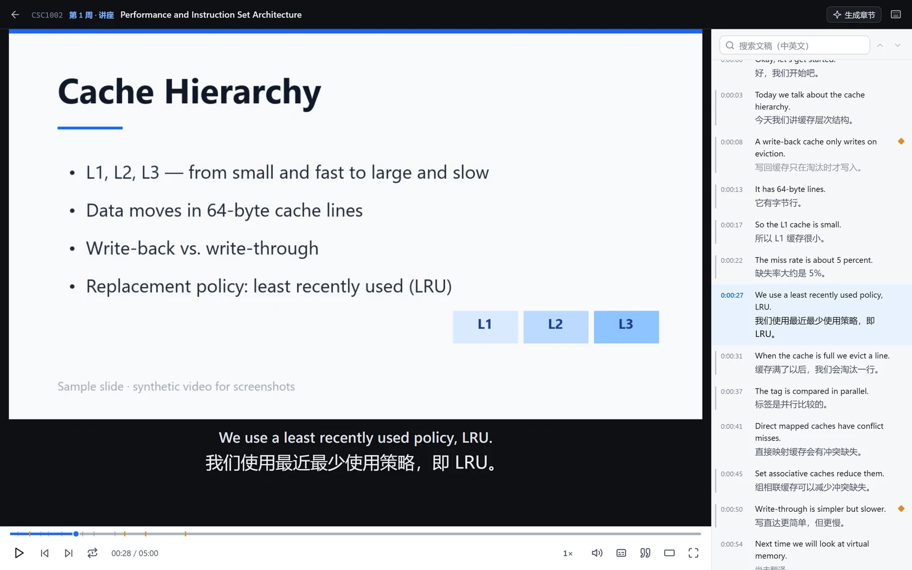
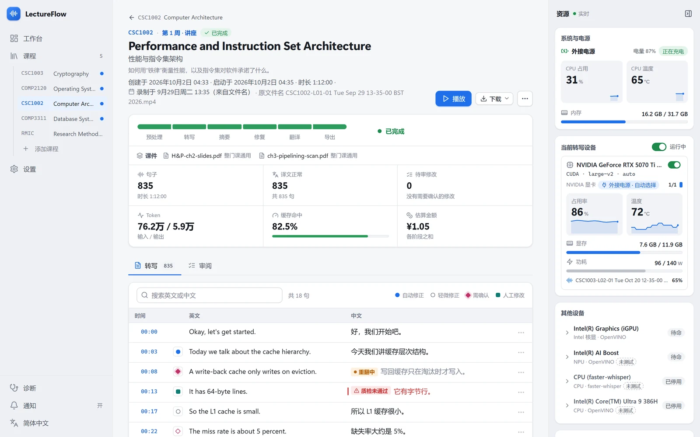
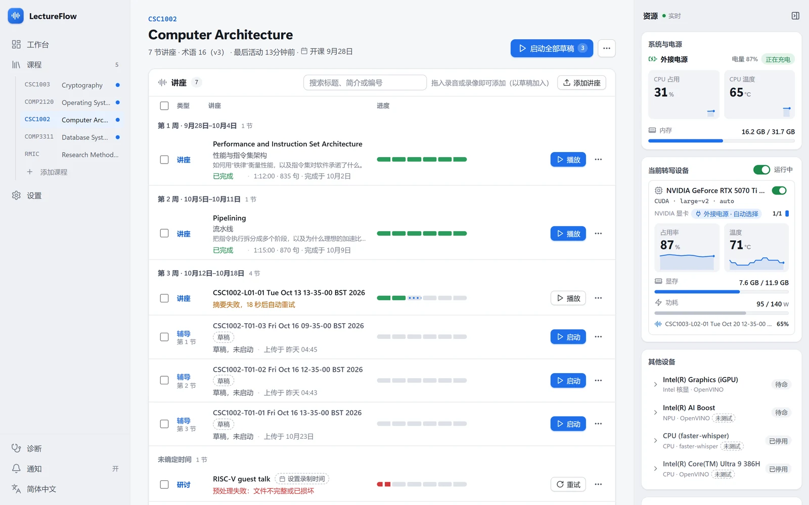
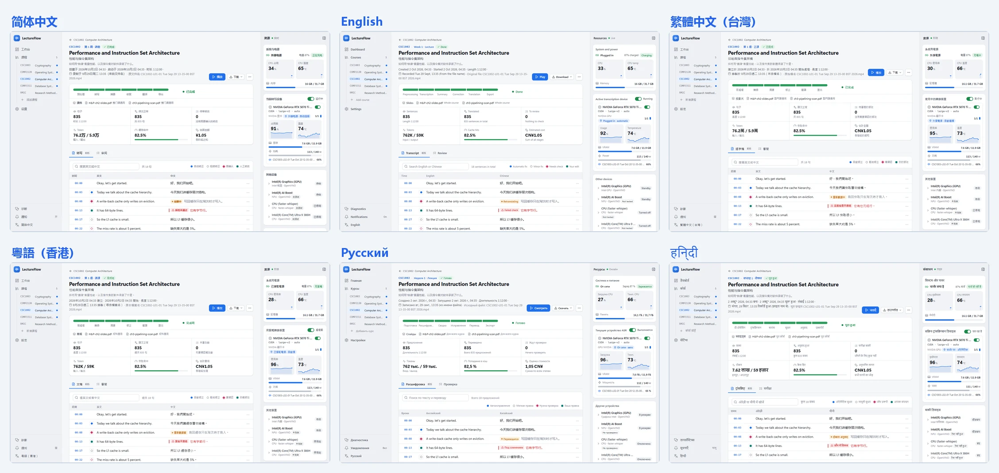

<h1 align="center">LectureFlow</h1>

<a href="README.md">English</a> · <a href="README.zh-CN.md">简体中文</a> · <a href="README.yue-HK.md">粵語</a>

  
  
  

**给每一个没办法在第一遍就听懂的人，一次不慌不忙的第二次机会。**

一个简约但不太简单的讲座听写与翻译工具，或许还有更多。

LectureFlow 是一个运行在你自己电脑上的讲座工具。把课程录像拖进去，它会在本机把语音转成文字，结合课件和术语表修正听错的地方，翻译成你的母语，然后在一个不遮挡课件的播放器里，陪你把这节课重新看一遍。

<picture>
  <source media="(prefers-color-scheme: dark)" srcset="docs/images/readme/player-zh-CN-dark.webp">
  
</picture>

截图使用虚构的演示数据和合成课件。

## 为什么会有 LectureFlow

**1. 学费买来的“智能字幕”**
大学每年为商业录播平台付出一笔不小的费用，换来的是：字幕把 “cache” 写成 “cash”，好像老师在讲理财；整整五行字压在课件正中央，公式和字幕只能二选一；播放器至今没学会“回到上一句”。钱是学校付的，罪是学生受的。LectureFlow 想证明：这些问题，一台普通的笔记本就能解决。

**2. AI 什么都懂，就是不记得老师在哪说的**
把整节课的抄本丢给 AI，它会很自信地讲解一番；至于这句话是老师在第几分钟说的，它一概不知，你也无从查证。LectureFlow 导出的每一句都带着精确到秒的引用，交给任何 AI 整理笔记，它写下的每个结论都能一键跳回课堂原声。

**3. 默认你是英语母语者**
录播平台的字幕只有一种语言。可当你用第二语言上课时，挡住你的往往不是知识，而是那个没听清的词、那句太快的长句。LectureFlow 把整节课翻译成你的母语，逐句对照。

**4. 翻得越通顺，错得越自然**
没有术语表的机器翻译只能靠猜：“block” 是“块”还是“分组”，全凭运气；老师的口误和识别错误，它会照单全收，再翻成一句语法完美的胡话。LectureFlow 先从你的大纲和课件里整理出这门课的术语表，再结合整节课的上下文修正识别错误，最后才开始翻译。

**5. 按月付费，买一份没法核对的摘要**
不少“一键把讲座变笔记”的产品按月收费：把录像传到它们的服务器，用不认识你这门课的语音识别转成文字，再写一份漂亮却无从查证的摘要；你的录像离开了你的电脑，笔记被锁在它们的应用里。LectureFlow 不替你写笔记，而是让任何笔记都可以被核对：录像留在本机，地基先修正，引用精确到秒，导出的文件永远属于你。

## 它是为谁做的

课堂默认每个人都能专心坐满一小时、一遍听懂、当场记好笔记。现实中很多人做不到，而这并不是因为不够聪明：

- **用第二语言上课的留学生**：不必在“听懂英语”和“理解内容”之间二选一。
- **精力有限的学生**：兼职打工的、照顾家人的、重返校园的。课可以晚点看、分几次看。
- **需要照顾注意力和精神健康的学生**：走神了，一键回到刚才那一句；没听懂，就让这一句多播几遍。
- **听力不便、阅读较慢的学生**：专业术语准确的字幕，可调的字号与播放速度。
- **手头只有一台普通笔记本的学生**：不需要昂贵的独立显卡，也可以完全不花钱。

如果你曾经因为错过一节课而焦虑，或者对着一段听不清的录像反复拖进度条，这个工具就是为你做的。

## 它能做什么

**把录像变成可以复习的讲稿**

- 在本机转写讲座录音，生成逐句、带时间戳的文稿。
- 根据课程大纲和课件整理术语表，再由另一个模型“清道夫”清理，专业术语从第一句起就是对的。
- 结合整节课的摘要和前后文修正听错的地方、逐句翻译；没把握的修改会标出来，可以点开听原声确认。
- 自动生成每节课的中英文标题、一句话简介和章节。

<picture>
  <source media="(prefers-color-scheme: dark)" srcset="docs/images/readme/lecture-zh-CN-dark.webp">
  
</picture>

**一个为学习设计的播放器**

- 字幕放在视频下方的独立区域，**不遮挡课件和板书**。
- 逐句文稿随播放滚动，点击任意一句即可跳转。
- 上一句、下一句、单句循环、慢速播放，都有快捷键。
- 关掉再打开，从上次的位置继续；一键复制精确到秒的引用。

**自动整理课程**

- 由 AI 根据你的文件名写出解析规则，按录制日期自动编号（如 `W02L1`：第 2 周第 1 节），按教学周分组。
- 区分讲座、辅导、研讨等课程类型。

<picture>
  <source media="(prefers-color-scheme: dark)" srcset="docs/images/readme/course-zh-CN-dark.webp">
  
</picture>

**会看电源脸色的转写**

- 自动选择 NVIDIA 显卡、Intel 核显或 NPU、Apple Silicon 来转写。
- 笔记本一次只用一台转写设备：插电用独显，拔电换到更省电的 NPU；无法迁移的任务会挂起，接回电源后继续。
- 可选借用 Google Colab 的 GPU：自动开机、转写、取回结果、关机，一分钱都不让它多烧。

**平静，不催促**

- 添加讲座、点一次“开始”，之后全部自动完成，不需要你盯着。
- 审阅修改是可选的：有精力时认真看看，没精力时直接拿成品复习。
- 任何一步出了问题，都会用人话告诉你发生了什么、可以怎么做。

**方便和其他工具一起用**

- 导出中英对照讲稿、双语字幕（VTT），以及带时间戳引用的 JSON，可以交给其他 AI 整理笔记。

## 隐私

- **录音和转写都在你自己的电脑上完成**，不会上传到任何地方。
- 只有当你配置了模型服务之后，转写出的文字才会发送给**你自己选择**的服务商，用于修复、摘要和翻译；也可以选择“只转写”，完全不用任何在线服务。
- 使用 Google Colab 后端时，录音会上传到 Google 的服务器，选择时会明确提示。
- LectureFlow 不收集任何使用数据，没有遥测，没有账户。

## 转写后端

| 后端 | 状态 | 一句话 |
| --- | --- | --- |
| NVIDIA CUDA | 已支持 | 你甚至可以用 A100！只要你有。~~（维护者需要六块 A100 来测试这个项目）~~ |
| Intel 核显（Iris Xe / Arc / Xe3） | 已支持 | 意外地强，调好配置后能和独显有来有回。 |
| Intel NPU | 已支持 | 适合带“Copilot+ PC”标识的轻薄本拔电时用；光有 Copilot 按键不够。 |
| Apple MLX | 实验性 ? | Only Apple can do. 尚未在真机上验证。 |
| Google Colab | 已支持 | 借 Google 的卡，自动开机、转写、关机。付费额度推荐，免费层尽力而为。 |
| AMD 显卡 / APU | 计划中 \* ? | 还没找到设备测试，会有的。 |
| CPU | 仅台式机兜底 ! | 反正都是计算，前提是跑得动。笔记本上坚决不用。 |

## 模型服务（修复、摘要、翻译）

| 服务 | 支持范围 | 一句话 |
| --- | --- | --- |
| DeepSeek | 全功能，**推荐主力** | 便宜，一节课几毛钱；输出偶尔不稳定，靠重试和质检兜底。 |
| Claude | 全功能 | 更贵更稳。有 API 额度时，推荐用在修复和术语整理。 |
| Gemini | 全功能，零成本档位主力 | 免费额度够你白嫖，代价是限速，让它夜里慢慢跑。 |
| ChatGPT | 基本支持 | Sam Altman 的名字得拆开看：前半边和山姆超市一样贵，后半边一不小心就把你的钱包打爆。 |
| OpenRouter | 全功能 | 一个入口塞满各家模型。维护者从没用过，你懂的。 |
| 本地 Ollama | 仅翻译，自动化能力在路线图 | 反正你都买了。推荐 Gemma 4 14B，效果不差。 |
| DeepL / 混元 | 路线图，仅翻译 | 逐句翻译、看不到上下文，口误和指代会明显变差。 |
| 其他 OpenAI / Anthropic 兼容接口 | 未测试 | 理论上都能接，接上了能不能用，看缘分。 |

## 要花多少钱

- **转写永远免费**：它在你的电脑上运行（借 Colab 时按你自己的额度计）。
- **修复与翻译**需要调用大语言模型，按目前常见服务的价格，一节一小时的课通常只要几毛钱人民币。
- 引导界面提供几种档位：**标准**、**省钱**、**零成本**（免费额度，处理得慢一些）、**只转写**（完全不花钱），随时可以更改。

状态说明：\* 可能支持本地转写与翻译一体完成，视开发者的睡眠和朋友们的测试结果而定；? 理论上支持但未完整测试；! 我们真的不推荐，容易~~起火~~影响睡眠。

## 开始使用

1. 从 [Releases](https://github.com/ShouldBeQuincy/LectureFlow/releases) 下载对应系统的安装包：Windows 用 `LectureFlow-Setup-3.0.0-x64.exe`（或便携版），Apple Silicon Mac 用 `LectureFlow-3.0.0-arm64.dmg`。
2. 安装包目前没有代码签名，系统会弹出安全提示，放行方法见 [docs/install.md](docs/install.md)。
3. 打开 LectureFlow，跟着引导走几步：选择语言、检测电脑、选择费用档位、下载组件。每一步都可以跳过，之后再回来。
4. 添加一门课程：填写课程名称和开课日期，可以顺便粘贴课程大纲、上传课件（不是必须的，但能明显提高专业术语的准确度）。
5. 把讲座录像拖进去，点击“开始”。处理完成后，点击“播放”。

## 界面语言

English · 简体中文 · 繁體中文（台灣） · 粵語（香港） · Русский · हिन्दी

除简体中文外，其他语言的界面文案由 AI 翻译，并以母语者角色审校。如果你是这些语言的母语者，非常欢迎帮忙改进。

## 局限

- **目前只在计算机科学专业的学生中测试过**，讲座语言为英语、翻译目标为简体中文。医学、法律、人文等学科的术语和讲课风格不同，效果可能有差别，欢迎告诉我们。
- macOS 与 Apple Silicon 尚未在真机上验证。
- AMD ROCm 尚未支持；多推理后端的调度还不够智能。
- 自动转写、修复和翻译都可能出错，重要的内容请回到原声确认。
- 它为**有参考资料的知识型内容**设计，不是通用的视频字幕工具：电影、动画、直播请找更合适的工具。

## 它不能替代什么

- 它**不能替代上课本身**，也不能替代学校提供的正式无障碍支持。如果你需要学校依法提供的人工字幕或笔记服务，请联系学校的相关部门。
- **请遵守你所在学校关于课堂录像的规定。** LectureFlow 适合处理学校正式提供给你的录播；未经允许自行录制课堂，可能违反学校的规定。

## 关于这个仓库：“流氓开源”声明

这是一个开源项目，但它的开源方式可能和你习惯的不太一样。先把话说在前面：

**代码是怎么写出来的**

- 这里的代码几乎全部由 AI 生成（Claude Code）。维护者负责的是：决定做什么、为谁做、做到什么程度，编写需求与规格，做出取舍，以及验收。
- **维护者没有逐行审阅每一行代码。** 质量靠的是自动化测试（单元测试、端到端测试、许可证审计）、多个 AI 之间的交叉审查，以及**维护者本人每天都在用它看课**。它首先是维护者自己的工具，坏了会第一个被骂。
- 如果你对 AI 生成的代码有顾虑，这很正常。请在使用、部署或修改之前，自行做你认为必要的审查。

**仓库里有什么、没有什么**

- 有：完整的源代码、测试、用户文档、许可证与第三方声明。
- 没有：开发过程中的工作文件，包括进度记录、决策日志、需求规格、AI agent 的指令与角色定义。想用 AI 工具参与开发，请根据代码和文档编写你自己的指令文件。

**提交历史为什么这么“粗”**

- 外部贡献者的提交原样保留，作者信息不变。
- 由 AI 生成的提交会在每个版本发布时压缩：每一段连续的 AI 提交合并成一个，与外部提交按原来的顺序排列。
- 只涉及文档（docs）或维护杂务（chore）的提交照常保留。
- 用 `git bisect` 定位问题时，AI 生成的部分最细只能精确到这些压缩后的提交；报告问题时请附上版本号，维护者手里有完整的内部历史。

这样做，是因为这个项目首先是维护者“自私优先”的工具，其次才是开源项目。我们宁可把规则说清楚，也不想假装成一个每一行都由人手写和审阅的项目。如果你更喜欢传统的方式，许可证允许你 fork 它、用你自己的方式维护。

## 路线图

- 更多讲座语言：日语、韩语、德语、法语
- 远端主机（SSH）后端、AMD ROCm 支持
- 按静音边界切块的转写检查点
- 在播放器中围绕整门课提问，回答附带精确到时间点的引用
- 为大学无障碍服务提供人工校对与字幕编辑界面：AI 打草稿，人来把关

## 参与贡献

欢迎提交问题、建议和代码，参与之前请先阅读 [CONTRIBUTING.md](CONTRIBUTING.md)；代码贡献需要签署贡献者许可协议（[CLA.md](CLA.md)）。特别欢迎：母语者改进界面翻译；在不同电脑上测试转写速度与准确度；提供可以公开使用（如 CC0）的讲座录音与人工审核过的抄本。

这个项目首先服务于维护者自己的学习，所以有些需求可能不会被采纳。被拒绝不代表你的想法不好，只是这里的精力有限。

## 许可证

本项目以 GNU Affero 通用公共许可证第 3 版或更高版本（AGPL-3.0-or-later）发布，见 [LICENSE](LICENSE)。如果你修改了 LectureFlow 并通过网络向他人提供服务，需要向这些用户提供修改后的源代码。另有一项依据许可证第 7 条的附加许可，允许把 LectureFlow 与 [LICENSE-EXCEPTION.md](LICENSE-EXCEPTION.md) 中列出的库组合使用。第三方组件的许可证见 [THIRD_PARTY_NOTICES.md](THIRD_PARTY_NOTICES.md)。

## 致谢

感谢 Whisper、faster-whisper、OpenVINO、FFmpeg、Electron，以及所有让这一切成为可能的开源项目。[示例讲座](assets/sample/SOURCE.md)来自法拉第《蜡烛的化学史》的 LibriVox 公共领域录音。

也感谢每一个在深夜对着录像努力听懂一节课的人。这个工具是为你们做的。
