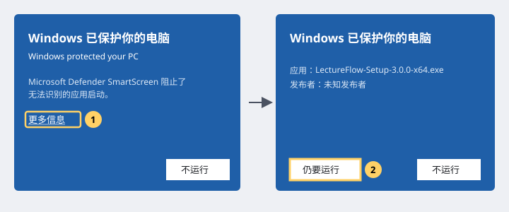
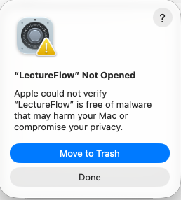
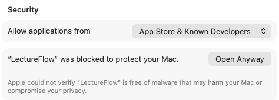
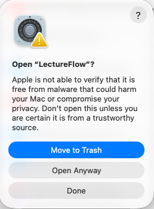

# 安装 LectureFlow

[简体中文](#简体中文) · [English](#english)

## 简体中文

### 下载哪个文件

在项目的 Releases 页面下载：

| 系统 | 文件 | 说明 |
|---|---|---|
| Windows 10 / 11（64 位） | `LectureFlow-Setup-<版本>-x64.exe` | 安装版，推荐。安装到当前用户，不需要管理员权限，可以选择安装位置 |
| Windows 10 / 11（64 位） | `LectureFlow-<版本>-x64-portable.exe` | 便携版，不安装，双击即可运行（每次启动要先解压，稍慢） |
| macOS 12 及以上（Apple 芯片：M1 及更新） | `LectureFlow-<版本>-arm64.dmg` | 打开后把 LectureFlow 拖进“应用程序” |

安装包只包含程序本身。转写所需的运行环境和模型，在第一次启动时按你的电脑配置下载（引导里会说明大小）。

无论安装版还是便携版，数据都保存在：Windows `%APPDATA%\LectureFlow\`，macOS `~/Library/Application Support/LectureFlow/`（可以在设置里改到别的磁盘）。卸载程序不会删除这些数据。

### 未签名版本的提示

LectureFlow 的安装包可能没有代码签名证书（是否购买证书由维护者决定）。这种情况下，系统第一次打开时会提示“无法识别的应用”。这是对所有未签名程序的通用提示，不代表发现了问题。如果你是从项目的 Releases 页面下载的，可以按下面的步骤继续。

#### Windows：SmartScreen

1. 双击安装包后，如果出现蓝色窗口“Windows 已保护你的电脑”，点击文字链接 **更多信息**。
2. 窗口里会出现“应用：LectureFlow-Setup-…”和“发布者：未知发布者”，点击 **仍要运行**。
3. 之后按安装向导操作即可。以后启动 LectureFlow 不会再出现这个提示。

*示意图，不是截图；文字以系统实际显示为准。真机截图待补。*

便携版第一次运行时也可能出现同样的提示，处理方法相同。

#### macOS：隐私与安全性

1. 打开 `.dmg`，把 LectureFlow 拖进“应用程序”文件夹（也可以放在外置盘的任意文件夹里）。
2. 双击 LectureFlow。系统提示“未打开 LectureFlow”，点击 **完成**，不要点“移到废纸篓”。

   

3. 打开 **系统设置 → 隐私与安全性**，向下滚动到“安全性”一节，可以看到“已阻止 LectureFlow 以保护你的 Mac”，点击旁边的 **仍要打开**。

   

4. 在弹出的对话框里再点击一次 **仍要打开**。

   

5. 输入登录密码（或使用触控 ID）确认，LectureFlow 随即打开。

*截图来自 macOS 27（英文界面），其他版本与语言的文字可能略有不同。*

只需要做一次。macOS 15 起，右键点按“打开”已不能跳过这个提示，请使用“系统设置”。

### 更新

从配置了更新仓库的正式发布版安装时，LectureFlow 会在启动时和之后每 6 小时检查一次新版本（自行构建、未配置更新仓库的版本不检查更新，也不显示更新提示，请手动下载新版本）。发现新版本时，在设置页与工作台底部提示，**由你决定**是否下载；下载完成后，可以选择“退出时安装”，有任务正在运行时不会安装。设置里可以选择稳定版或测试版。

未签名的 macOS 版本无法自动安装更新（macOS 的要求），请到 Releases 页面下载新的 `.dmg` 覆盖安装，数据不受影响。

---

## English

### Which file to download

From the project's Releases page:

| System | File | Notes |
|---|---|---|
| Windows 10 / 11 (64-bit) | `LectureFlow-Setup-<version>-x64.exe` | Installer, recommended. Installs for the current user, no administrator rights needed, installation folder can be changed |
| Windows 10 / 11 (64-bit) | `LectureFlow-<version>-x64-portable.exe` | Portable, nothing to install (unpacks itself on every start, so it starts a little slower) |
| macOS 12 or later (Apple silicon: M1 or newer) | `LectureFlow-<version>-arm64.dmg` | Open it and drag LectureFlow to Applications |

The installer contains the app only. The transcription runtime and models are downloaded on first start, chosen for your computer (the guide shows the sizes).

Your data lives in `%APPDATA%\LectureFlow\` (Windows) or `~/Library/Application Support/LectureFlow/` (macOS); it can be moved to another disk in Settings. Uninstalling does not delete it.

### Unsigned builds

The installers may not be code-signed. Your system then warns that the app is unrecognised the first time you open it. This warning appears for every unsigned program; it does not mean anything was found. If you downloaded the file from the project's Releases page, continue as follows.

**Windows (SmartScreen):** on the blue "Windows protected your PC" window, click **More info**, then **Run anyway**. The warning does not come back afterwards. The portable version may show the same warning.

**macOS:** drag LectureFlow to Applications (or any folder, also on an external drive) and open it. When macOS says "LectureFlow" Not Opened, click **Done** (not "Move to Trash"). Open **System Settings → Privacy & Security**, scroll to "Security", click **Open Anyway** next to "LectureFlow was blocked to protect your Mac", click **Open Anyway** again in the dialog that follows, then confirm with your password or Touch ID; LectureFlow opens. This is needed once. Since macOS 15, Control-clicking "Open" no longer skips the warning. The macOS screenshots above are from macOS 27; the Windows pictures are schematic.

### Updates

Release builds that were built with an update repository check for a new version at start and every 6 hours (builds made without one, for example your own builds, never check and show no update notice; download new versions by hand). A new version is announced on the Settings page and at the bottom of the dashboard; **you decide** whether to download it. Once downloaded you can choose "Install when I quit"; an update is never installed while tasks are running. Settings let you choose the stable or the beta channel.

Unsigned macOS builds cannot install updates by themselves (a macOS requirement): download the new `.dmg` from the Releases page and install it over the old one; your data is not affected.
